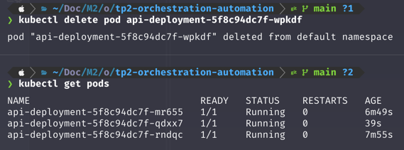
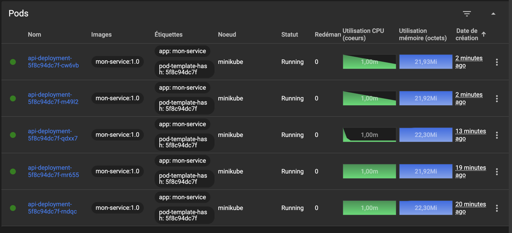

# Captures d'écran

### Capture des trois pods en train de run

### Capture de l'auto-réparation après la suppresion d'un pod (Voir celui qui marche depuis 30s)

### Capture après up-scaling (dashboard web), passage à 5 pods

# Réponses aux questions de compréhension

## 1. Quelle est la différence entre une image Docker et un conteneur Docker ?

Une image est un modèle en lecture seule avec des paramètres définis qui sert de base pour créer des conteneurs. Un conteneur est une instance en cours d'exécution de cette image.

## 2. Pourquoi les données de la base sont-elles perdues si l'on supprime le volume, mais pas si l'on supprime seulement le conteneur ?

Les données de la base sont stockées dans le volume (`donnees_db`) et pas dans le conteneur lui-même. Supprimer le conteneur ne touche pas au volume, les données persistent et seront réutilisées si un nouveau conteneur s'y attache. En revanche, supprimer le volume détruit définitivement les données qu'il contient.

## 3. Un Deployment Kubernetes déclaré avec `replicas: 3` perd un pod. Que fait Kubernetes, et pourquoi parle-t-on d'approche déclarative ?

Kubernetes détecte que l'état réel (2 pods) ne correspond plus à l'état désiré (3 pods décrit dans le manifeste) et recrée automatiquement un nouveau pod pour revenir à 3. On parle d'approche déclarative car on décrit l'état souhaité sans indiquer les commandes à exécuter. C'est Kubernetes qui se charge en permanence de réconcilier l'état réel avec l'état désiré.

## 4. Quel est le rôle du Service par rapport aux pods, sachant que ces derniers sont recréés régulièrement avec une nouvelle adresse IP ?

Le Service fournit un point d'accès stable vers un ensemble de pods sélectionnés via des labels. Il joue le rôle de **load balancer** et redirige le trafic vers les pods disponibles. Même quand ceux-ci sont recréés et changent d'adresse IP, évitant ainsi de dépendre d'une IP de pod instable.

## 5. Citez deux limites de Docker seul (sans Kubernetes) que vous avez observées ou apprises ce matin

- Pas d'auto-réparation : si un conteneur crashe ou est supprimé, Docker seul ne le recrée pas automatiquement pour maintenir un nombre de réplicas donné.
- Pas de gestion native de la scalabilité ni du load balancing entre plusieurs instances d'un même service. Alors que Kubernetes gère nativement via les Deployments et les Services.
